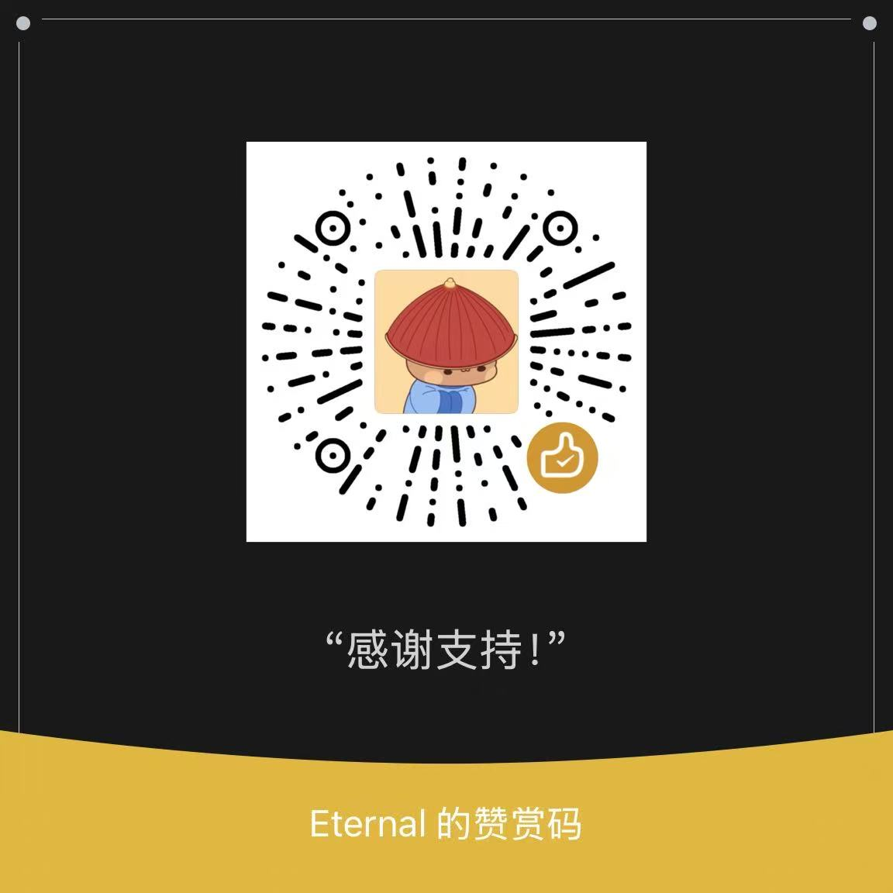

# WeAppDev

**不装微信，也能跑小程序，Devtools，提供插件 API，实现自己的小程序扩展脚本！**

手机装一个 APK，输入 AppID 就能跑；连上电脑，Chrome 能给业务代码下断点。

    

<a href="https://weappdev.top">官网</a> · <a href="https://github.com/RYF5584/WeAppDev/releases">下载</a> · <a href="#联系">加群</a>

## 这是什么

WeAppDev 是一个可以**脱离微信运行小程序和小游戏**的 Android 应用。它自带一套小程序运行时，把运行环境和调试工具装进一个 APK：不用装微信，不用 Root，也不用 Xposed。

## 能做什么

- **跑起来**：输入 AppID 直接打开小程序或小游戏，最近使用、多账号切换都在
- **DevTools**：Chrome 连 `:9400`，断点、作用域、调用栈、Console 全都有
- **抓包**：Network 明文看请求与响应，支持改写规则和 `onRequest` / `onResponse` 脚本
- **Native 捕获**：云开发、云网关的 `operateWXData` 请求也能抓，插件可解密
- **插件**：一个 HTML 就是一个小程序扩展，跳一跳无敌、页面文字编辑都是插件
- **车机**：普通 APK，车机能装 APK 就能用，默认横屏

## 下载

到 [Releases](https://github.com/RYF5584/WeAppDev/releases) 下载最新的 `WeAppDev-*.apk`。

## 文档

完整文档在官网 [weappdev.top](https://weappdev.top)：安装、DevTools、抓包与改写、插件 API。

## 关于本仓库

**本仓库不包含源代码**，只用于发布 APK、收集 Issue 和索引文档。项目不开源，请勿索要源码。

## 联系

- 公众号：**We逆向**（回复「加群」进交流群）
- 微信：`RSCompanyCEO`
- 问题反馈：[Issues](https://github.com/RYF5584/WeAppDev/issues)

| 公众号 | 微信 | 赞赏 |
| :---: | :---: | :---: |
|  |  |  |
| 扫码关注，回复「加群」 | 扫码添加 | 请我喝杯咖啡 |

## 声明

本应用仅供学习研究使用。请勿用于商业用途或大规模分发，请勿用于未授权的目标。
